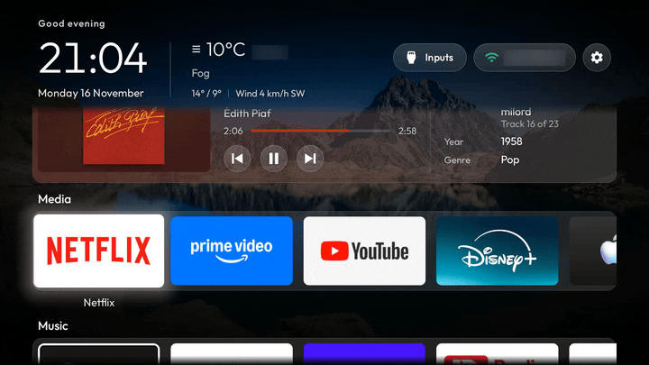
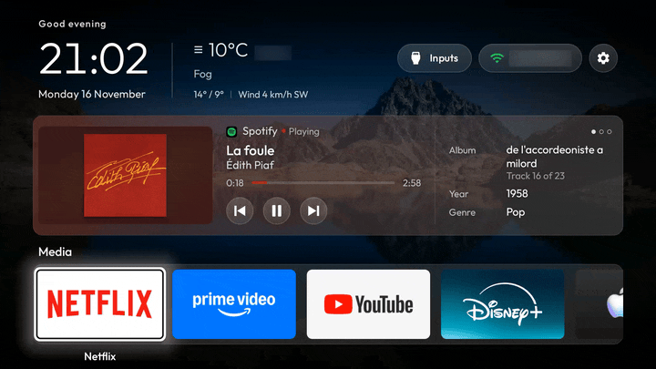
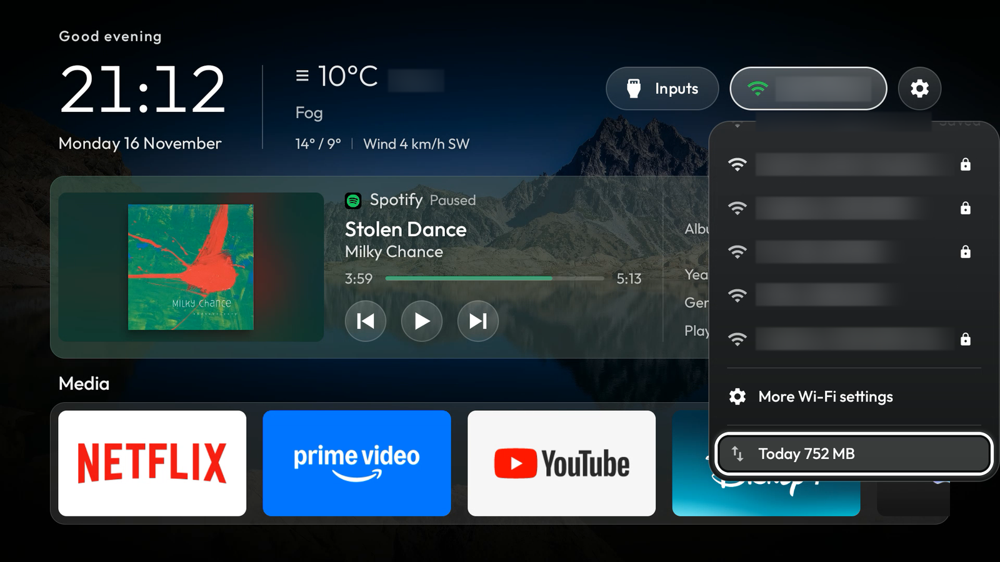
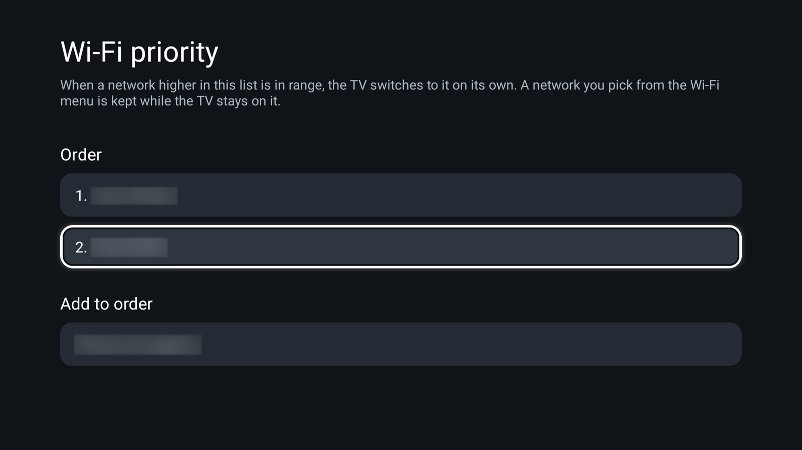
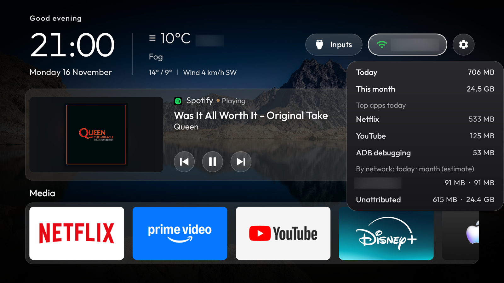
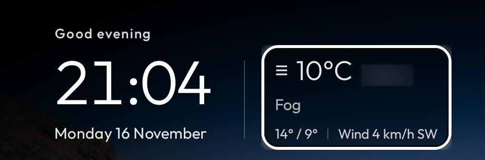

<h1 align="center">rehome</h1>

<p align="center">
  <b>A clean home screen for Philips Android TVs that live on phone hotspots.</b><br>
  Apps in rows, a card for whatever you were watching, Wi-Fi in one press, and the bloat switched off.
</p>

<p align="center">
  <a href="LICENSE"></a>
  
  <a href="https://github.com/leopierini/rehome/releases/latest"></a>
</p>

<p align="center">
  
</p>

<p align="center"><sub>Network names and the city are blurred. App names such as <i>Guida TV</i> come from the TV, set to
Italian.</sub></p>

I don't have Wi-Fi at home. My TV, a Philips 55OLED706, runs on phone hotspots, and moving it from one hotspot to
another through the stock Android TV settings meant a trip through several screens every time. The stock home screen
was slow and full of promoted rows. So I rebuilt the Home and the Wi-Fi around how the TV is actually used: one press
to turn Wi-Fi on, one press to join a saved hotspot, an order between hotspots, a data counter for metered ones, and a
clear offline state. Then I switched off the apps that had no business running on it.

rehome installs from a computer over the network, with no root. It disables apps and never uninstalls them, and one
command puts the TV back the way it was.

**[Install](#install)** · [Latest release](https://github.com/leopierini/rehome/releases/latest) ·
[Guide](docs/guide.md) · [Why it works this way](docs/ux.md)

## Features

### Apps in rows, by category

Home is a few titled rows: Media, Music, Games and Tools, plus Other apps for anything that fits none of them. A new
app lands in the right row by itself. Four tiles fit across, and a row scrolls right for the rest. Hold OK on a tile
to move it left or right, move it to another row, hide it, or open its app info.

<p align="center">
  
</p>

### A player for what you watched last

Above Media sits a wide card with the last things you watched or listened to, in any app: up to six, the most recent
first. Left and Right browse them, and each kind gets its own card:

- **a song**: ⏮ ⏯ ⏭ and a progress bar, with album, track number, year and genre. ⏯ resumes Spotify even after the
  app was closed;
- **a video** (YouTube): Resume, its length and when you watched it;
- **a series** from apps that publish to Android TV's Watch Next (RaiPlay is one): title, episode and season, and
  Resume opens that episode;
- **an app that shares nothing** about what's playing, such as Netflix: a card to go back to it, with where you left
  off.

With nothing to resume, the card isn't there. Hold OK on it to remove an item.

<p align="center">
  
</p>

### Wi-Fi in one press

OK on the Wi-Fi pill opens a dropdown instead of the system settings. If Wi-Fi is off, **Turn on** switches it on
right there and the networks appear under it. Saved networks are marked **Saved** and come right after the connected
one. Pick one and the dropdown closes, while the pill shows a spinner and the network's name until the TV is on it.
Android's own screens open only to type a password: for a network the TV has never joined, or when a saved password
is rejected. The pill's icon is green when the internet works, orange while it isn't confirmed yet, and red with no
network.

<p align="center">
  
</p>

Turning Wi-Fi on and joining a saved network take a small helper app, because Android 11 allows that only to apps
built for an older Android version ([why](docs/ux.md#why-there-is-a-wi-fi-helper-app)).

### An order between hotspots

Put your saved hotspots in order in **Launcher settings › Wi-Fi priority**. After each scan, if a network higher in
the list is in range with a usable signal, the TV moves to it, at most once a minute. A hotspot with no internet after
40 seconds is set aside (15 minutes, then 30, 60, up to 4 hours) and the next one is tried. A network you pick by hand
in the dropdown stays until the TV leaves it. The order starts empty, and with no order the TV stays on whichever saved
network it joins.

<p align="center">
  
</p>

### A data counter for metered hotspots

The last row of the Wi-Fi dropdown shows how much data the TV used today. OK on it opens the detail: today, this
month, today's top three apps, and each network's share. It reads Android's own usage statistics, on the TV.

<p align="center">
  
</p>

### Weather

Beside the clock: temperature, sky, today's high and low, rain in the next few hours ("Rain from 18:00") and the wind
with its direction, from [Open-Meteo](https://open-meteo.com). Pick your city by name in Launcher settings; until then
the spot says **Set your city** and nothing is fetched.

<p align="center">
  
</p>

### Focus you can see from the sofa, and remote shortcuts

The focused tile gets a white ring and a soft glow in the colour of its banner, and its name appears under it. The
pills, the weather, the dropdowns and the settings use the same ring. On Home, the digits 1–9 open the app in that
position of the Media row. The four colour keys do nothing special on Home until you give each one an app in your
own build (`home_color_keys` in `config.xml`, see [Remote shortcuts](docs/guide.md#remote-shortcuts)); there's no
on-TV setting for them. Home on the remote always brings focus back to the first app in Media.

<p align="center">
  
</p>

### A clear offline state

When the TV has had no working network for 10 seconds, the pill says **No network**, the weather spot says
**Offline: check your Wi-Fi or hotspot**, and the apps that need the internet turn grey (they still open). Home asks
for a Wi-Fi scan every 45 seconds, so the TV rejoins a saved hotspot as soon as it's back, and Home returns to normal
within seconds.

### The cleanup

The installer disables 25 packages on this family of TVs, each with a one-line reason in
[`cleanup/ph1m_ea_9970a.txt`](cleanup/ph1m_ea_9970a.txt): TP Vision's telemetry, Philips promo and store apps, the
retail demo, the Alexa bridge, TalkBack, Google first-setup leftovers, Play-Fi and Mimi, and the Google TV launcher
(about 190 MB resident) with its recommendation service. Rakuten TV and TED are an optional group it asks about.
Everything is disabled with `pm disable-user`, never uninstalled. The installer refuses to touch streaming apps,
Assistant, Chromecast, the Play Store, firmware updates, the TV, tuner and HDMI services, or the Google Home phone
remote.

### Speed

On the 55OLED706 the launcher starts cold in about 500 ms (492–517 ms measured) and uses about 50 MiB with the player
active. Scrolling is smooth while the panel runs at 60 Hz. After 50 Hz content such as live TV the panel can stay at
50/100 Hz, and then scrolling stutters in any launcher; opening any streaming app usually brings 60 Hz back. The
installer can also set Android's animation scale to 0.25 for snappier menus (optional, and restore undoes it).

## Supported TVs

Philips Android TV 11 sets on the **PH1M_EA_9970A** board (MediaTek MT5895, firmware `TPM211…`). The TV reports its
board as `TP1M_EA_9970A`; the installer accepts both names. Known models on this board:

| OLED | Other |
|---|---|
| 55OLED706, 65OLED706, 55OLED707, 65OLED807, 65OLED907 | 65PML9506, 50PUS8517 |

Not the 55OLED708, which uses a different board.

**Tested on one 55OLED706 only.** The other models share the same package set, so rehome should work on them too. If
you try it on one, please [open an issue](https://github.com/leopierini/rehome/issues) and say how it went, even if
everything worked.

The launcher itself runs on any Android TV 8 or newer, but the cleanup list and some defaults (the Live TV app, the
OLED notes) are for this family. On another board the installer stops, and `--any-board` installs only the launcher,
with no cleanup.

## Install

You need a computer on the same network as the TV, with Python 3.9 or newer and `adb` from Android platform-tools:

- **macOS:** `brew install python android-platform-tools` (or `xcode-select --install` for Python alone).
- **Debian and Ubuntu:** `sudo apt install python3 adb`.
- **Windows:** install WSL with Ubuntu (`wsl --install`), then use the Debian and Ubuntu line inside it. If the scan
  doesn't find the TV from WSL, give its address with `--host`.

1. **Turn on debugging on the TV**, with the remote: Settings › Device Preferences › About, press OK on **Build** seven
   times; then Settings › Device Preferences › Developer options › **USB debugging: On**. On these TVs that also opens
   debugging over the network, on port 5555.
2. **Run the installer:**

   ```sh
   git clone https://github.com/leopierini/rehome.git
   cd rehome
   ./install.sh --dry-run    # look first: connects, backs up, prints the plan, changes nothing
   ./install.sh
   ```

3. **Accept "Allow USB debugging?"** on the TV the first time it connects.

`install.sh` goes step by step and asks once before it changes anything:

1. checks for Python 3.9+ and `adb`, and says how to get `adb` if it's missing;
2. finds the TV (`--host <tv-ip>`, or a scan of your local network for port 5555) and connects;
3. reads the board and model, and stops on a board it doesn't know;
4. saves a backup of the TV's state (installed and disabled packages, the Home app, the animation scales) in
   `~/.rehome/backups/`;
5. shows the cleanup plan, with a reason for each package and what it skips;
6. downloads both APKs from the latest release, disables the list, installs the launcher and its Wi-Fi helper,
   grants the permissions the features need, makes rehome Home, checks that it is still on screen a few seconds
   later, and only then disables the stock launcher. If rehome falls over or Home doesn't end up on it, it gives
   Home back to the stock launcher;
7. offers the faster animation scale;
8. prints what is left to do by hand.

| Option | What it does |
|---|---|
| `--dry-run` | Steps 1–5 only: shows the plan and changes nothing on the TV |
| `--host <tv-ip>` | Connects to this address instead of scanning (Settings › Network & Internet shows it) |
| `--local` | Installs the APKs you built (`app/build/…`, `wifi/build/…`) instead of downloading them |
| `--with-optional` | Also disables the optional group (Rakuten TV, TED) |
| `--animations` | Sets the system animation scale to 0.25 |
| `--any-board` | On a board rehome doesn't know: installs the launcher only, with no cleanup |
| `--yes` | Doesn't ask (for scripts) |

**Then, by hand:**

- **Play Protect** may stop the Wi-Fi helper with "App blocked". Press **Install anyway** with the remote. The helper
  targets an old Android version on purpose: on Android 11 that's the only way an app can turn Wi-Fi on and join a
  saved network. If it was blocked, run `./install.sh` again. Without the helper, the Wi-Fi dropdown falls back to
  the TV's own Wi-Fi screens.
- **Turn debugging off** when you're done: Developer options › USB debugging: Off, then **Revoke USB debugging
  authorizations**, then restart the TV from its menu. Until then, anyone on the same network or hotspot can reach the
  TV's debugging port ([details](docs/troubleshooting.md#turn-debugging-off-when-youre-done)).
- On an OLED, switch the TV off with the remote, not at the wall, and wait about 15 seconds after the install before
  unplugging it: Android writes the disabled state to disk with a delay.

### With a coding assistant

[`AGENTS.md`](AGENTS.md) is the same procedure written for a coding assistant. Open this repo in one that reads it and
ask it to install rehome on your TV: it runs the same tool, shows you each step, and asks before every change.

### Build it yourself

You need JDK 17 and the Android SDK (platform 34 and build-tools 34), with `sdk.dir` in `local.properties` or
`ANDROID_HOME` set.

```sh
./gradlew assembleRelease testReleaseUnitTest
./install.sh --local
```

Your APKs are signed with the debug key unless you set `REHOME_STORE_FILE`, `REHOME_STORE_PASSWORD`,
`REHOME_KEY_ALIAS` and `REHOME_KEY_PASSWORD` (as Gradle properties or environment variables). Android won't update an
app with one signed by a different key, so your build can't replace the release APKs in place: run
`python3 tools/rehome.py restore --uninstall` first, then install your build. Sign both apps with the same key: the
launcher talks to the Wi-Fi helper through a permission only apps with the same signature get.

## Settings

Hold OK on the gear at the top right and choose **Launcher settings** (OK alone opens the TV's own settings). There
you set the weather city, the Wi-Fi priority, the song details lookup, the clock format and the wallpaper, reset the
row order, and bring back hidden apps. The six built-in wallpapers rotate every 10 minutes. The [guide](docs/guide.md)
covers every setting, the remote shortcuts, the player, themes, and the `config.xml` keys for your own build.

## Restore

```sh
python3 tools/rehome.py restore              # enable what rehome disabled, give Home back, reset the animation scales
python3 tools/rehome.py restore --uninstall  # the same, then remove rehome and its Wi-Fi helper
```

`restore` uses the earliest backup of that TV, so it returns to the state before the first install: it enables what
rehome disabled, and any package you disabled by hand since that was already on the TV at the time of the backup.

## After a firmware update

A firmware update enables the disabled apps again and can give Home back to the stock launcher. Turn debugging on and
run `python3 tools/rehome.py check`, then `python3 tools/rehome.py check --fix`.
[docs/firmware-update.md](docs/firmware-update.md) has the details, and the trade-offs of automatic updates on a
hotspot.

## OLED care

Switch the TV off with the remote, not at the wall: the panel's care cycle runs in standby. After a long viewing, wait
10–15 minutes before unplugging. Philips' own screensaver (a moving logo) starts after about 6 minutes without a key
press; that's the panel's protection, so let it run. More in [docs/oled.md](docs/oled.md).

## Privacy

Everything is on by default, as on my TV. What leaves the TV, and how to turn each part off:

- **Weather → [Open-Meteo](https://open-meteo.com).** The forecast request carries the coordinates of the city you
  picked, about every 30 minutes while the weather is on. The city search sends what you type to Open-Meteo's
  geocoding service. No key, no account. Off: Launcher settings › Weather city › **Turn weather off** (it stays off
  until you pick a city).
- **Song details → Apple's [iTunes Search API](https://performance-partners.apple.com/search-api).** The artist and
  title of a song the player remembered, once per song, for the album, track number, year, genre and cover. Off:
  Launcher settings › **Look up song details** (then no request is made). Revoking notification access (below) also
  stops it, because the player then remembers no songs.
- **Pictures that apps publish as web links** (posters, covers) are downloaded once from those links and kept on the
  TV.

What stays on the TV:

- **What plays in other apps.** The installer gives the launcher notification access, so the player can see the
  media sessions of other apps (title, artist, app, position, artwork) while they play. The player's memory stays in
  the launcher's private storage. Hold OK on the card to remove an item. Off:
  `adb shell cmd notification disallow_listener io.github.leopierini.rehome/.MediaListener` (the player then shows
  only what apps publish to Watch Next).
- **Data counter.** Android's usage statistics, read on the TV. Off:
  `adb shell cmd appops set io.github.leopierini.rehome GET_USAGE_STATS default` (the counter then shows only the total
  since the last restart).
- **Location permission.** Android requires it to read the Wi-Fi network's name and the saved networks. Nothing reads
  your position.

No analytics, no crash reports, no accounts, no ads. Apart from the requests above, rehome sends nothing.

## Credits

- The launcher's base and part of the cleanup list come from [CleanYourTV](https://github.com/Gathin23/cleanyourtv)
  (MIT).
- [Outfit](https://github.com/Outfitio/Outfit-Fonts) font by The Outfit Project Authors (SIL Open Font License 1.1).
- Weather data by [Open-Meteo.com](https://open-meteo.com) (CC BY 4.0).
- Wallpapers: six CC0 photos from Unsplash, credited in [docs/wallpapers.md](docs/wallpapers.md).

Licences and notices: [THIRD_PARTY_NOTICES.md](THIRD_PARTY_NOTICES.md).

## Contributing and support

Reports from other models in this family are the most useful thing right now. Bugs and ideas go in
[Issues](https://github.com/leopierini/rehome/issues); read [CONTRIBUTING.md](CONTRIBUTING.md) before a pull request,
and [SECURITY.md](SECURITY.md) to report a vulnerability privately.

## License

rehome is released under the [MIT License](LICENSE). Bundled fonts, photos and the code it builds on keep their own
licences; see [THIRD_PARTY_NOTICES.md](THIRD_PARTY_NOTICES.md).
