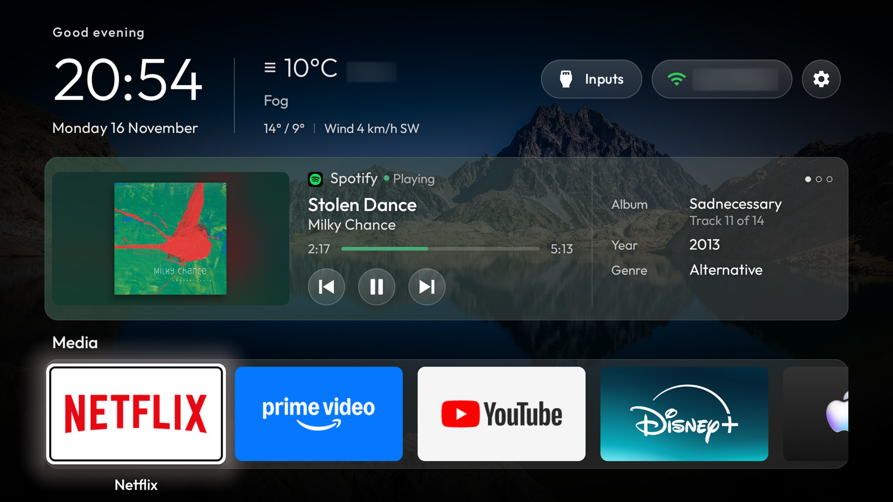
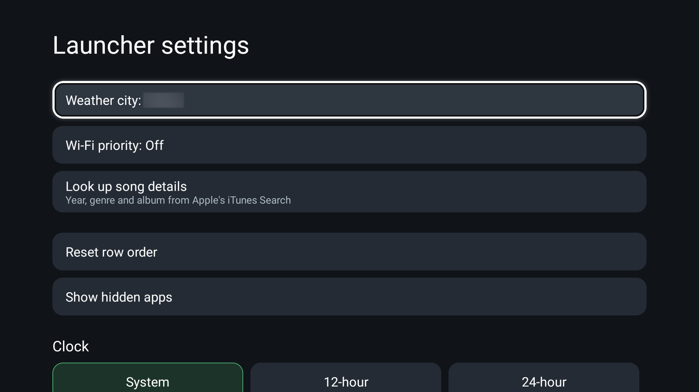
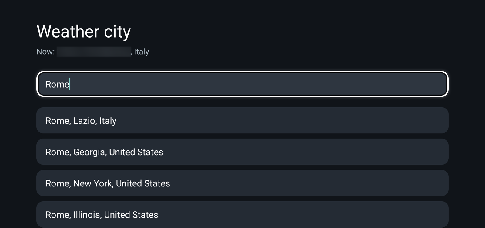
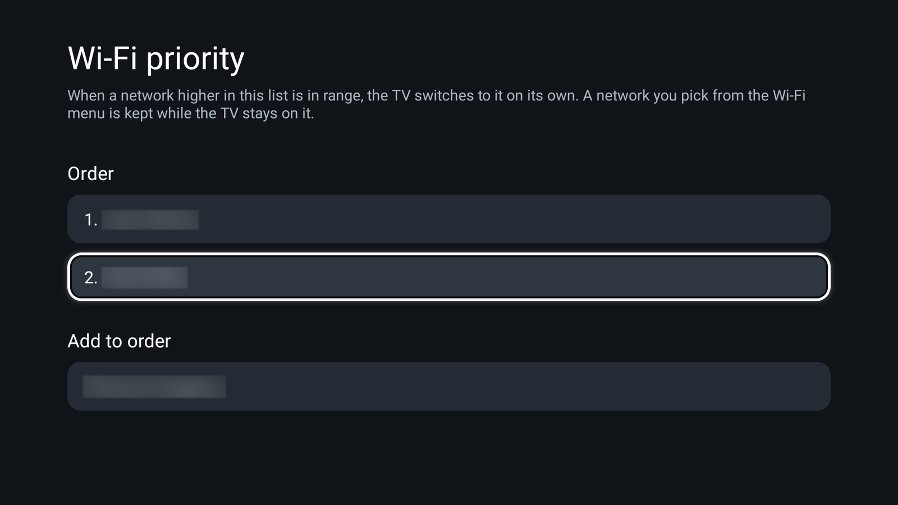
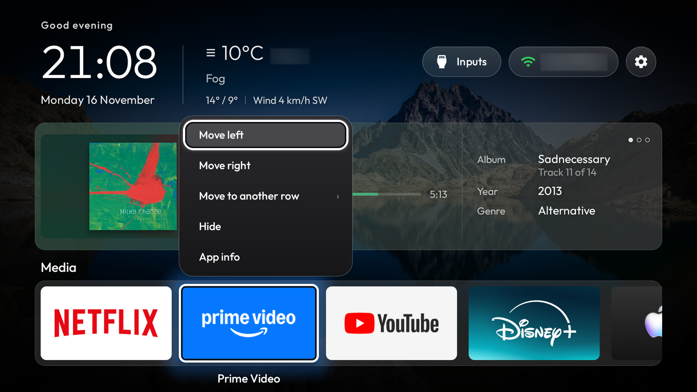
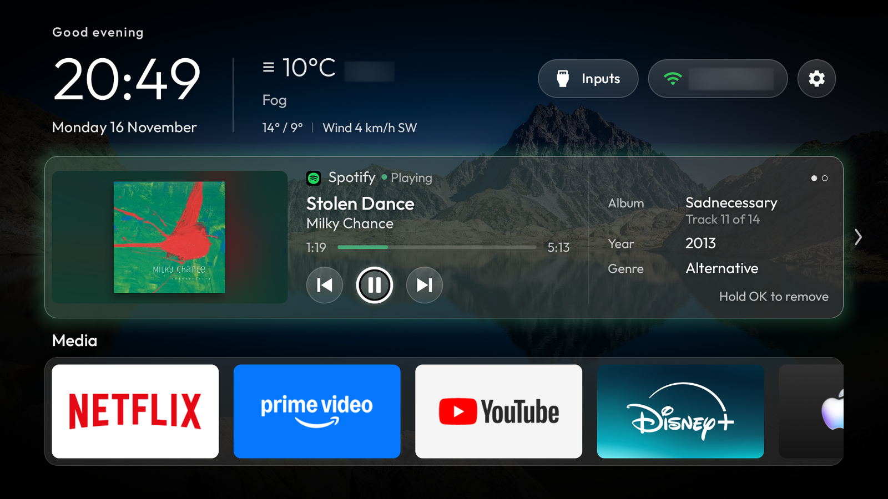
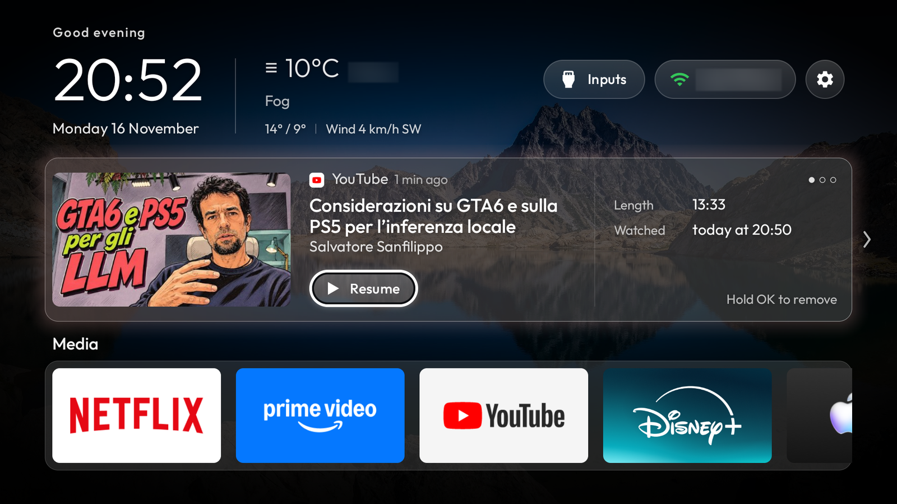
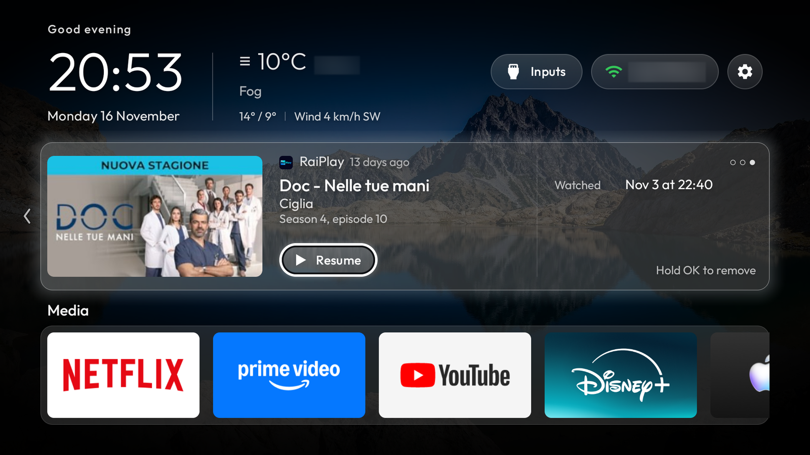
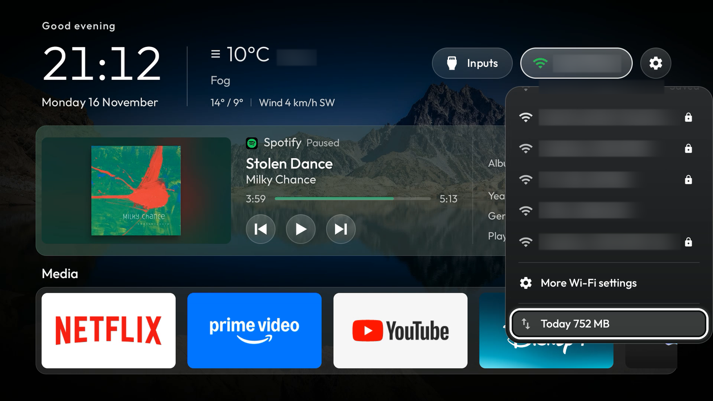
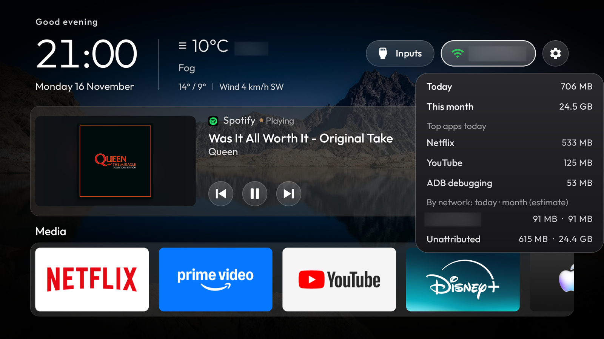

# rehome guide

How to use rehome once it's installed, every setting, and the options for your own build. To install it, see the
[README](../README.md#install).

- [Getting around](#getting-around)
- [Launcher settings](#launcher-settings)
- [Rows and tiles](#rows-and-tiles)
- [Remote shortcuts](#remote-shortcuts)
- [The player](#the-player)
- [Wi-Fi, hotspots and the data counter](#wi-fi-hotspots-and-the-data-counter)
- [Offline](#offline)
- [Wallpapers and themes](#wallpapers-and-themes)
- [Your own build: config.xml](#your-own-build-configxml)
- [Living on a hotspot](#living-on-a-hotspot)
- [TV settings worth a look](#tv-settings-worth-a-look)

## Getting around

<p align="center">
  
</p>

<p align="center"><sub>The city and the network name are blurred.</sub></p>

- **Top left:** a greeting, the clock and the date, then the weather. Focus the weather and press OK to change the
  city (or to open the weather app set in `weather_app`, in your own build).
- **Top right:** the pills. **Inputs** lists the inputs that have something connected, with Live TV at the end.
  **Wi-Fi** opens the [Wi-Fi dropdown](#wi-fi-hotspots-and-the-data-counter). The **gear** opens the TV's own settings;
  hold OK on it for [Launcher settings](#launcher-settings). While network debugging (ADB) is on, a red
  **Debugging on** pill comes first (OK opens Developer options) and Inputs shrinks to an icon to make room. The gear
  is always just the icon, so the weather keeps its room.
- **Middle:** the [player](#the-player), when there's something to resume.
- **Below:** the [rows](#rows-and-tiles).

Up from the first row goes to the player, or to the header when there's no player. Down from the header comes back.
Home on the remote always brings focus to the first app in Media.

## Launcher settings

Hold OK on the gear, then choose **Launcher settings**. The rows, top to bottom:

| Row | What it does |
|---|---|
| **Weather city** | Search a city by name and pick it. **Turn weather off** removes the weather from Home. |
| **Wi-Fi priority** | The order between your saved networks (see [below](#an-order-between-hotspots)). Shows "Off" with no order. |
| **Look up song details** | Asks Apple's iTunes Search for the album, year and genre of a song the player remembers (see [Song details](#song-details)). OK switches it on or off. |
| **Reset row order** | Puts every app back where rehome placed it, and shows hidden apps again. Asks first. |
| **Show hidden apps** | Brings back the apps you hid, and keeps your other changes. |
| **Clock** | System, 12-hour or 24-hour. |
| **Wallpaper** | The built-in rotation (**Theme default**), one picture held, or **None** for a plain background. |
| **Animations** | Home's own animations on or off. |
| **Advanced effects** | A lifted tile, icon zoom and colour transitions; uses more memory. Off by default. |
| **Follow theme** | Clears the clock, wallpaper and animation choices made here, back to the theme's or built-in values. The weather city, Wi-Fi priority and song details choice stay. |
| **Choose default home** | Opens Android's Home picker, to switch between rehome and the stock launcher (the stock launcher must be enabled; `tools/rehome.py restore` does that). |
| **TV system settings** | The TV's own settings. |

<p align="center">
  
</p>

The line at the bottom, "Weather: Open-Meteo.com (CC BY 4.0)", is the attribution the weather data's licence asks for.

Changes apply when you go back to Home. They're kept in the launcher's private storage, so they survive an update
that keeps the app's data.

### Weather city

Type a few letters with the TV keyboard; results appear after a short pause, or at once with the keyboard's Search
key. They come from Open-Meteo's geocoding service in English or Italian, as "Name, Region, Country". The search
looks up the name only; add a region or country after a comma ("Rome, Italy") to put those places first. OK on a
result saves it and goes back. The forecast is refreshed about every 30 minutes, and the rain line looks 6 hours ahead.

<p align="center">
  
</p>

### An order between hotspots

**Wi-Fi priority** lists the networks saved on the TV (the Wi-Fi helper reads them), in two parts:

- **Order:** the networks in priority order, most wanted first. OK on one: **Move up**, **Move down**, **Remove from
  order**.
- **Add to order:** saved networks that aren't in the order yet. OK adds one at the end.

<p align="center">
  
</p>

Each change is saved at once and counts from the next Wi-Fi scan. The rules:

- After each scan, if a network higher in the order is in range with a signal of −75 dBm or better, the TV moves to
  it, at most once a minute.
- A network reached this way that gives no internet within 40 seconds is set aside for 15 minutes, then 30, 60 and so
  on up to 4 hours when it keeps failing, and the next one is tried. A network the TV can't join is set aside for
  10 minutes.
- A network you pick by hand from the dropdown is kept, whatever the order says, until the TV leaves it.
- With an empty order the TV stays on whichever saved network it joins, as stock Android does.
- Saved networks in the Wi-Fi dropdown follow the same order.

A network joins the list once you have connected to it on the TV (from the dropdown, with its password). The page
needs the Wi-Fi helper; without it, it says so. The automatic switching is covered by tests, but it has seen little
use with several real hotspots in range: if it does something odd, please open an issue.

## Rows and tiles

Home starts with four rows, **Media**, **Music**, **Games** and **Tools**, filled from a list of well-known apps,
plus **Other apps** for what fits none of them. An app installed later is placed by what it is (a streaming app in
Media, a music app in Music, and so on). Only the focused tile shows its name; tiles without a banner always do.

**Hold OK on a tile** for its menu:

- **Move left**, **Move right**: within the row;
- **Move to another row**;
- **Hide**: takes it off Home (it stays installed);
- **App info**: Android's page for the app.

<p align="center">
  
</p>

Your changes are kept across restarts. **Reset row order** and **Show hidden apps** in Launcher settings undo them.

## Remote shortcuts

Only while Home is in front, with no dropdown or menu open. Inside apps the keys work as usual.

- **1–9** open the app in that position of the Media row, as you've arranged it.
- **Colour keys** (red, green, yellow, blue) can each open an app. They do nothing special by default; set them in
  `home_color_keys` in [your own build](#your-own-build-configxml), one `colour|package` per item:

  ```xml
  <string-array name="home_color_keys" translatable="false">
      <item>red|com.netflix.ninja</item>
      <item>yellow|com.google.android.youtube.tv</item>
  </string-array>
  ```

  A package that isn't installed, or is disabled, does nothing. `adb shell pm list packages` lists the names.
- **Home** brings focus back to the first app in Media.

## The player

A wide card above Media with the last things watched or listened to in any app: up to six, the most recent first.
With nothing to show, it isn't there.

- **Up** from Media moves into the card, on its main button. **Down** goes back to Media, in the same column.
- **Left** and **Right** browse. On a song they first move across ⏮ ⏯ ⏭, then on to the next item. Dots in the
  card's top right corner show where you are, and arrows at the edges show there's more.
- **Up** from the card goes to the header, to the item you used last there.
- **Hold OK** on the card: **Remove from player**. The item stays away until you play it again.
- Without focus the card always shows the most recent item.

What each card shows:

| | |
|---|---|
|  | **A song.** ⏮ ⏯ ⏭ control the app that's playing; the card follows a track change within a few seconds. ⏯ on a song from Spotify resumes it even after the app was closed (it can take up to about 16 seconds). Album, track number, year and genre come from the [iTunes Search API](#song-details); the progress bar stops moving after a minute without key presses, so nothing moves on an idle Home. |
|  | **A video** (YouTube). **Resume**, its length and when you watched it. YouTube doesn't share the video's ID, so Resume goes back to the video while YouTube is still open in the background, and otherwise opens YouTube. |
|  | **A series**, from apps that publish to Android TV's Watch Next row: title, episode and season. **Resume** opens that episode. At the time of testing, RaiPlay, Twitch, Red Bull TV and Disney+ published there; Netflix, Prime Video and YouTube didn't. |
| | **An app that shares nothing** about what's playing, such as Netflix: **Back to Netflix**, where you left off, and **Open Netflix**. |

Without a picture, the app's banner fills the space. The card and its glow take their colour from the picture.

How it knows: the launcher has notification access (the installer grants it), which lets it see other apps' media
sessions while they play. An item is remembered after 10 seconds of playback and updated every 30 seconds and on
every track change. Spotify's ads are skipped, and the TV's own tuner is ignored (`player_ignore_apps`). Only the
session that most recently started playing counts, because some apps keep saying "playing" after they lose the
audio. The memory stays in the launcher's private storage on the TV.

### Song details

For each song it remembers, the launcher asks Apple's iTunes Search API once for the album, track number, year,
genre and a square cover, and keeps the answer on the TV. The request carries the artist and the title, and goes to
the iTunes store of the TV's region (the US store when the TV's language setting has no region). To turn it
off, press Launcher settings › **Look up song details** until it says "Off": no request is made from then on, and the
card shows only what the app sends. `player_lookup_online` in [your own build](#your-own-build-configxml) sets the
default the row starts from.

### Turning the player off

- Stop it watching other apps: `adb shell cmd notification disallow_listener io.github.leopierini.rehome/.MediaListener`.
  The card then shows only Watch Next items. `allow_listener` with the same name turns it back on.
- No player at all: `category_player` (or `category_watch_next`) to `false` in your own build.

## Wi-Fi, hotspots and the data counter

<p align="center">
  
</p>

<p align="center"><sub>Network names blurred.</sub></p>

OK on the Wi-Fi pill opens the dropdown:

- **Wi-Fi off:** a **Turn on** row. OK switches Wi-Fi on without closing the dropdown ("Turning on Wi-Fi…"), then the
  networks appear with focus on the first. The TV usually joins a saved network in range by itself within seconds.
- **The networks:** the connected one first (no lock: you're already on it), then the saved ones, marked **Saved**,
  in your [priority order](#an-order-between-hotspots), then the rest by signal. A lock means the network needs a
  password you haven't given the TV. With more networks than fit on screen, the networks scroll, and **More Wi-Fi
  settings** and the data row stay at the bottom.
- **Pick a saved network:** the dropdown closes and the pill shows a spinner and the network's name until the TV is
  on it. After 30 seconds without success you see "Couldn't connect to …" and the TV stays where it was.
- **Pick a new network**, or one whose saved password is rejected: Android's own screen opens to type the password.
- **More Wi-Fi settings:** the TV's Wi-Fi settings. Holding OK on the pill opens them too.
- **Up** on the first row closes the dropdown and goes back to the pill, like Back.

The pill's icon: green when the internet works, orange when the TV is on a network but the internet isn't confirmed
yet, red with no network. The bars in the dropdown show each network's signal.

Turning Wi-Fi on and joining a saved network go through the **rehome Wi-Fi helper**, a small app with no icon and no
screen ([why it exists](ux.md#why-there-is-a-wi-fi-helper-app)). Without it, the dropdown opens the TV's own Wi-Fi
screens instead. To remove it: `adb uninstall io.github.leopierini.rehome.wifi`.

### The data counter

The last row of the dropdown reads **Today 843 MB** (for example). OK opens the detail:

- **Today** and **This month** (the calendar month);
- **Top apps today**: the three apps that used the most;
- **By network: today · month (estimate)**: each Wi-Fi network's share.

<p align="center">
  
</p>

Back goes back one level at a time. The numbers come from Android's usage statistics, which the installer lets the
launcher read. Without that permission the row shows only the total since the last restart. While network debugging
is on, its own traffic counts too, as **ADB debugging**.

## Offline

After 10 seconds with no working network:

- the Wi-Fi pill says **No network**;
- the weather spot says **Offline: check your Wi-Fi or hotspot**;
- apps that need the internet turn grey. They still open. The Tools row is never greyed, and neither are the TV's own
  apps and local players, which work without a network.

Meanwhile Home asks for a Wi-Fi scan every 45 seconds, so the TV rejoins a saved network as soon as one is back.
When the network returns, Home goes back to normal within seconds.

## Wallpapers and themes

Home rotates through six built-in photos ([credits](wallpapers.md)), a new one every 10 minutes, in random order,
darkened by 55 % so white text stays readable. Launcher settings › **Wallpaper** holds one picture, or turns the
wallpaper off.

To use your own pictures or change the look without building the app, push a **theme folder** to the TV:
`/sdcard/Android/data/io.github.leopierini.rehome/files/`. Everything in it is optional:

| File | What it does |
|---|---|
| `wallpapers/` | A folder of JPEG pictures (1920×1080 is right) that replaces the six built-in ones. |
| `wallpapers/captions.txt` | A name for each picture, `file.jpg<TAB>Name`, one per line; shown with `"wallpaper_captions": true`. |
| `wallpaper.jpg` | A single picture, used when there's no `wallpapers/` folder. |
| `config.json` | Overrides for `config.xml` keys, for example `{"wallpaper_rotation_minutes": 30, "wallpaper_dim": 40, "wallpaper_order": "sequential"}`. Unknown or mistyped keys are ignored. |

```sh
adb push wallpapers /sdcard/Android/data/io.github.leopierini.rehome/files/
adb push config.json /sdcard/Android/data/io.github.leopierini.rehome/files/
adb shell am force-stop io.github.leopierini.rehome     # then press Home on the remote
```

Home reads the folder when it starts, hence the force-stop. When `config.json` changes, the clock, wallpaper and
animation choices made in Launcher settings are cleared, so the theme's values show. Delete the folder's contents to
go back to the built-in look.

Keys a theme can set include the wallpaper ones (`wallpaper`, `wallpaper_rotation_minutes`, `wallpaper_order`,
`wallpaper_dim`, `wallpaper_true_color`, `wallpaper_captions`, `wallpaper_moods`), the clock screensaver
(`clock_wallpaper`, `clock_wallpaper_dim`, `clock_glow`, `home_idle_clock_minutes`), the header (`show_greeting`,
`greeting_name`, `date_below_clock`, `header_white`, `wifi_status_color`, `show_inputs_pill`), `hidden_apps`,
`locale` and `launcher_settings_button`. The rows, the colour keys, the Wi-Fi priority list and the player keys
need a build.

## Your own build: config.xml

`app/src/main/res/values/config.xml` holds the defaults, each with a comment. Edit it and
[build](../README.md#build-it-yourself). The keys you're most likely to want:

| Key | Default | What it does |
|---|---|---|
| `category_rows_list` | Media, Music, Games, Tools | The rows, `Title\|package,package,…`, in order. Apps not listed are placed by kind. |
| `category_other_title` | Other apps | The row for apps that fit no other. |
| `hidden_apps` | Live TV app, Mimi, Play-Fi | Apps never shown as tiles. |
| `category_names_on_focus` | `true` | `false` shows every tile's name all the time. |
| `home_number_keys` | `true` | Digits 1–9 open the Media apps. |
| `home_color_keys` | empty | `colour\|package` for the colour keys (see [Remote shortcuts](#remote-shortcuts)). |
| `wifi_priority` | empty | A starting priority order. An order set on the TV replaces it. |
| `weather_city`, `weather_latitude`, `weather_longitude` | empty | A starting city. One picked on the TV wins. |
| `weather_app` | empty | An app OK on the weather opens; empty opens the city picker. |
| `category_watch_next` | `true` | Reads Android TV's Watch Next. `false`: no player at all. |
| `category_player` | `true` | The player card above Media. |
| `player_lookup_online` | `true` | Song details from the iTunes Search API. A choice made in Launcher settings wins. |
| `player_music_apps` | Spotify, YouTube Music, Amazon Music, … | Apps whose sessions are songs (⏮ ⏯ ⏭). |
| `player_ignore_apps` | the TV's tuner | Sessions never remembered. |
| `wallpaper_*` | on, 10 min, shuffle, 55 % | See [Wallpapers and themes](#wallpapers-and-themes). |
| `wallpaper_true_color` | `true` | `false` halves the wallpaper's memory (for 1 GB TVs), with some banding. |
| `wifi_status_color` | `true` | The green, orange and red Wi-Fi icon. |
| `locale` | empty | A language tag (`it`) to show the launcher in, instead of the TV's language. |
| `home_idle_clock_minutes` | `0` | Minutes on an untouched Home before rehome's clock screensaver; 0 is off. |
| `launcher_settings_button` | `false` | `true`: OK on the gear opens Launcher settings instead of the TV's settings. |
| `reduced_motion` | `false` | Shorter, calmer animations for a slow GPU. |
| `live_tv_package` | `org.droidtv.playtv` | The TV's Live TV app, at the end of the Inputs menu. |

## Living on a hotspot

rehome was built for a TV that only ever sees phone hotspots. What helps, besides the [priority
order](#an-order-between-hotspots) and the [data counter](#the-data-counter):

**On the phone**

- Turn on "Allow others to join" (iPhone) or the equivalent, so the TV can find the hotspot.
- On an iPhone, "Maximize Compatibility" on (2.4 GHz) is the safe choice for these TVs.
- A phone stops advertising its hotspot after a few minutes with nobody connected. If the TV can't see it, open the
  hotspot screen on the phone again.

**On the TV**

- Turn off wake on Wi-Fi (WoWLAN) and Chromecast network standby (in the network or general settings, depending on
  the firmware), so the TV in standby doesn't hold on to the hotspot.
- Set the Philips **switch-off timer** (Eco settings) so a film left running overnight doesn't use the data plan; the
  "switch off with no activity" timer is a good safety net too.
- Mark each hotspot as metered, so Android and the Play Store hold back background downloads:
  `adb shell cmd netpolicy set metered-network "<network name>" true` (`undefined` puts it back).
- Leave automatic firmware updates off and update on a better connection ([why](firmware-update.md)).

**In the streaming apps** most of the data is video. Rough figures per hour: SD 0.3–0.7 GB, HD 1.5–3 GB, 4K 6–7 GB.

- **Netflix:** data usage is set per profile on the website (Account › Profiles › Playback settings): Medium or High,
  not Auto. Turn off autoplay of the next episode there too.
- **Prime Video:** Settings › Streaming quality: Good or Better.
- **Disney+:** profile › App settings › Data usage: Save data.
- **YouTube:** turn autoplay off; during a video, OK › Quality › 720p instead of Auto.

Menu names change between app versions; look for the setting by meaning.

## TV settings worth a look

rehome doesn't change these: set them with the remote. The names come from the Philips menus of this family and may
differ a little on your firmware.

- **Picture style:** Filmmaker Mode or Home Cinema. The TV keeps a separate style for normal, HDR and Dolby Vision
  content, so set it once while each kind is playing.
- **Motion styles:** Pure Cinema or Film for films and series, Standard for sport.
- **Games:** the Game style (or Auto Game) on the console's HDMI input.
- **HDMI Ultra HD:** Optimal on every input with a 4K HDR device; otherwise the input stays limited.
- **Energy saving** (Eco settings): Off or Minimum. Higher values cap the brightness and make the picture look dim.
- **Privacy:** turn off usage and diagnostics sharing and ad personalisation in Android's settings, and review the
  Philips terms and consents.
- OLED panels: see [OLED care](oled.md).
